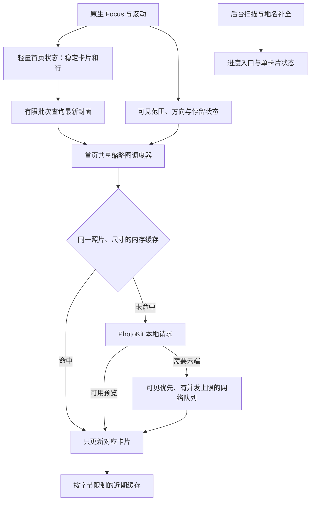

# 首页上下滚动与 iCloud 图片加载优化方案

日期：2026-09-10  
状态：用户已确认实施，核心改动已落地；具体实现、验证证据和真机限制见第 11 节。第 1–10 节保留设计依据，其中参数是工程预算，不代表已取得真机帧率验收。

## 1. 体验目标与结论

首页上下移动焦点和滚动必须及时响应。图片暂时在 iCloud 上时，只影响这张图片何时清晰出现，不应阻断下一排卡片、方向操作或返回。

建议组合实施：**本地缩略图优先、可见照片优先下载、有限缓存支持往返、首页按需更新**。不把“先下载完整照片库”作为流畅浏览的前提，也不承诺弱网下云端图片立即出现。

用户最终看到的行为：

- 向下浏览：下一排卡片提前存在；已有缩略图直接显示，暂时无图的卡片保持相同尺寸，仍能选中进入地点。
- 连续快速翻动：焦点和滚动跟随遥控器；已缓存的图正常出现，不为每个刚经过的地点都启动 iCloud 下载。
- 停留观看：优先补当前卡片和屏内照片；允许先显示同一照片的低清图，再替换为适合电视卡片的清晰图。
- 立即往回翻：优先复用刚看过的缩略图，减少重复请求和占位闪回；缓存被清理后依旧能正常导航。
- 断网或某张照片下载失败：只有相关卡片保持占位或已有预览，其余地点和导航继续可用。
- 地名补全与照片更新继续在前台任务中运行，不在每次完成后重排当前货架或重新加载全部封面。

本方案承接已有扫描、增量更新和详情地球功能。地名索引准备与图片准备是两件事：扫描继续只处理元数据和地名；首页只为有限浏览窗口准备缩略图，不增加全库图片下载阶段。

## 2. 当前实现中已确认的问题与边界

以下是静态代码事实，不等于已经测定每项对真机卡顿的贡献。

| 当前机制 | 对体验的可能影响 | 代码位置 |
| --- | --- | --- |
| 卡片 Button 和固定图片尺寸先存在，不等待下载 | 图片慢不必然导致 Focus 卡住；需要分别测量内容等待和交互停顿 | `GlobeOverviewView.swift:273`、`PlaceCard.swift:23` |
| 每张卡片的请求先在 MainActor 同步查找单个 PHAsset，再允许网络获取图片 | 新行进入时会集中执行资产查询并启动请求；同步查询成本需要真机确认 | `PhotoLibraryService.swift:88`、`:149` |
| 每个 loader 独立发请求；未建立共享的在途去重、优先级和并发预算 | 离屏或预测行的请求可能与正在看的图片竞争资源 | `PhotoLibraryService.swift:123`、`:207` |
| 最多 15 张图片驻留，离开窗口时取消并清空 UIImage | 内存有界，但反向滚动需要重新请求，依赖 PhotoKit 内部缓存 | `PhotoImagePolicy.swift:4`、`PlaceCard.swift:68`、`PhotoAssetImage.swift:87`、`PhotoLibraryService.swift:233` |
| Focus 回写父视图；父视图重新计算完整地点排序、标签字典，首页重新分行和计算年份 | 地点数量和已展开行数增大后，可能放大每次导航的同步工作 | `GlobeOverviewView.swift:36`、`:107`、`GlobeView.swift:68`、`:85` |
| 每个最新封面查询单独回写，查询前可能先请求另一张默认封面 | 一批新地点可能多次触发父层更新；同一卡片可能先后加载两个 ID | `GlobeView.swift:640`、`PlaceCard.swift:68` |
| 首页观察整个 AppModel；扫描进度、单个地名变化也发布到同一对象 | 无关状态可能扩大首页失效范围；不能把发布次数直接视为真实重绘次数 | `GlobeView.swift:14`、`AppModel.swift:16`、`:520`、`:552` |
| 15 + 10 控制数据展开，但 VStack 保留全部已展开卡片 | 深度浏览时布局和 Focus 图持续增长，可能成为独立瓶颈 | `GlobeOverviewView.swift:59`、`GlobeView.swift:654` |

当前图片请求采用 `.opportunistic`，没有设置同步等待 iCloud。PhotoKit 默认异步，可能先返回低清图、再返回清晰图，也可能在方法返回前立即回调已有图片。因此，不能把 `isNetworkAccessAllowed = true` 本身解释为“主线程同步下载”。[Apple：requestImage](https://developer.apple.com/documentation/photos/phimagemanager/requestimage(for:targetsize:contentmode:options:resulthandler:))

需要保留的已有保护：原生 Focus、直接承载货架的 VStack、固定卡片尺寸、1.025 的克制焦点缩放、初始 15 / 追加 10、图片比例与长边限制、旧请求结果隔离，以及首页与探索复用同一张地图。不能直接换成曾导致下一排无法寻址的全屏 LazyVStack，也不先降低地球画质。

## 3. 总体结构

三类范围分别管理，不再只靠 `loadsImage` 一个开关：

1. **导航范围**：初始 15 个地点、每次追加 10 个，卡片先进入原生 Focus 图。
2. **图片订阅范围**：焦点行和相邻有限行，基线最多 3 排 / 15 张；用实际可见行修正优先级，不能把预加载视图的 `onAppear` 当作已经可见。
3. **缓存范围**：保留有限数量已完成的近期缩略图，与视图是否存在分离，按真实内存成本淘汰。

滚动和 Focus 回调只更新轻量状态，不执行同步 PhotoKit 查询、不排序全库摘要、不等待封面 SQL 或网络结果。

## 4. 图片请求：本地优先，停留后补云端

### 4.1 请求优先级

| 对象 | 本地处理 | 云端处理 |
| --- | --- | --- |
| 当前焦点卡片 | 立即查缓存，未命中优先请求本地缩略图 | 停留后最高优先级；即使其他图很慢也要能获得执行机会 |
| 当前屏内其他卡片 | 次优先本地请求 | 焦点之后补齐，同一屏内避免单张长期占住队列 |
| 滚动方向的下一排 | 在既有图片窗口内做低优先级本地预热 | 首版不做离屏云端预取 |
| 刚离开的上一排 | 保留已完成缓存，允许窗口内本地复用 | 取消没有可见消费者的云端请求 |
| 更远货架或隐藏页面 | 仅保留轻量卡片数据；不订阅新图片 | 不产生新请求 |

连续移动状态优先使用系统公开滚动阶段和实际可见行；Focus 的行变化用于方向预测和遥控器兜底，不拦截首页全局方向键。约 200–300 ms 没有新的滚动/Focus 行变化后恢复云端调度，此等待**只影响新云端请求**，不延迟 Focus、行展开、本地缓存显示或已经完成的图片。

同一行左右移动只调整焦点优先级，不取消整行已在执行的下载。完成停留判定的新焦点遇到两个慢请求占满时，允许暂停其中一个较低优先级请求并归还槽位，每秒最多抢占一次；被暂停的可见请求保留预览和累计等待时间，恢复时优先于新来的普通任务。抢占是调度器的单项操作，不是移除其他消费者；迟到结果必须按请求代次隔离。上下方向改变时，立即丢弃过期预测任务并提升新焦点；不依靠等待旧队列自然清空。

### 4.2 两阶段 PhotoKit 获取

1. **本地阶段**：共享 `PHCachingImageManager`，明确设置异步和 `isNetworkAccessAllowed = false`，按统一尺寸请求缓存或设备上可用的表示。低清结果先保留；目标质量已经满足就结束。
2. **云端阶段**：本地结果表明需要网络、或目标表示尚不可用时，对仍可见且有需求的照片排入网络队列；设置 `isNetworkAccessAllowed = true`，继续接受渐进结果。

收到 degraded 回调只更新预览，不立即并行启动云端阶段；等待本地终态，或达到本地阶段截止后先结束该工作，再决定升级。同一逻辑请求不能同时占用本地和云端槽。本地阶段暂定 2 秒截止，未取得终态也应取消并释放应用额度；保留已有图，将结果记为“本地暂未取得”，对仍可见且资产有效的需求允许一次受控的网络许可重试，但不能据此显示“已确认在 iCloud”。

`PHImageResultIsInCloudKey` 表示这次请求的图片需要网络，不是对资产全部原图、缩略图的永久“本地/云端”分类。只在系统明确给出依据时显示云端提示；空结果也可能是权限、删除或错误，不能一律判定为 iCloud。[Apple：isNetworkAccessAllowed](https://developer.apple.com/documentation/photos/phimagerequestoptions/isnetworkaccessallowed)

本地预热和本地正式请求必须复用完全相同的目标尺寸、contentMode 和 options。网络阶段是不同请求配置，不能声称 local-only 预热一定命中网络请求的系统缓存；预热本身也不提供下载完成保证。[Apple：startCachingImages](https://developer.apple.com/documentation/photos/phcachingimagemanager/startcachingimages(for:targetsize:contentmode:options:))

### 4.3 调度、生命周期与失败

- 同一请求键只保留一个在途工作，用消费者订阅管理结果；一个卡片离开不能取消其他消费者仍需要的同一工作。
- PhotoKit 资产查找使用独立后台串行工作队列，有限批次解析 PHAsset 并短期复用；request/cancel 与调度状态有明确的串行执行边界，不能排在可能慢的资产批查后面而无法响应取消。UI 端只订阅结果。不能仅添加 `Task {}` 就认为工作已离开 MainActor；按 Swift 并发隔离规则设计对象所有权，不随意扩散 `@unchecked Sendable`。
- 当前代码 `.task { load() }` 只启动回调请求便结束。新订阅必须持有可取消句柄，页面隐藏、窗口退出、索引切换和权限变化显式释放，不能假设 SwiftUI task 自动接管完整下载生命周期。
- 准确处理同步首回调、多次 degraded 回调、取消后迟到回调、final 空图和错误。回写检查消费者、资产版本、请求 generation；旧请求不能清理新请求的句柄或覆盖新图片。
- 取消无消费者请求并及时归还应用调度额度，但不假设 PhotoKit 立刻停止内部下载；统计取消与重启频率，避免以反复取消制造请求风暴。
- 单张首页云端请求暂定累计执行 30 秒截止，抢占后恢复不重置已消耗时间；超时保留同一资产已有预览并释放队列，60 秒冷却后在再次可见时有限重试。每轮可见会话最多自动重试 1 次，手动重试与新的资产版本可重置；不让失败占住所有下载槽。该策略不套用到全屏详情的独立长图请求。
- 下载进度只使用 PhotoKit 提供的真实回调。首页不展示每张照片的百分比或大量转圈动画；超时不等同于照片不存在。

## 5. 缓存与清晰度

### 5.1 保留刚看过的图，但有明确内存上限

新增首页共享的缩略图缓存。离开订阅窗口释放卡片对图片的持有，已完成图可以留在缓存；不再要求移出第 15 张时立即从整个应用清除。

- 缓存键包含：照片真实 ID、内容修订、标准尺寸档、fit/fill 与图像版本配置。索引结构更新与照片内容修订分开，单纯地名补全不使图片失效。
- 可接受同一照片、同一修订的低清图作为升级占位；不同照片 ID 之间不能复用显示内容，缺失时绝不拿其他照片代替。
- 首页首版采用纯内存缓存和 PhotoKit 系统缓存，不增加永久照片副本、SQLite 图片字段或额外磁盘缓存维护。
- 应用自持有的首页图片统一记账，基线总预算 **48 MiB**（含可见/订阅图、近期缓存与可追踪的解码临时图），另设近期完成图最多 **40 项** 的次级上限。根据 `CGImage.bytesPerRow × height` 等实际成本估算，不能只按文件大小或图片张数计费。
- 启动请求或显示准备前预留预计输出和临时空间，接到结果按实际成本校正。预算不足先淘汰离屏图，再暂停升级或降低后续请求尺寸；PhotoKit 意外返回超大图时不长期持有它，不能把事后 LRU 淘汰等同于峰值保证。报告不可避免的回调交付瞬时峰值。
- 可见图优先保留，先淘汰最久未访问的离屏图；已完成缓存不因一次轻微方向变化清空。内存告警立即清理离屏缓存、停止预热并缩小订阅范围，必要时降低后续缩略图规格。
- PhotoKit/MapKit 的内部缓存、GPU 纹理及框架临时内存不在上述硬预算内，必须另测进程总峰值；不能把 48 MiB 宣称为整个页面的总内存。
- 删除、编辑、授权缩小立即失效相关缓存；失去照片权限清理全部私人图片及订阅。离开首页取消首页消费者，后台/休眠释放首页缓存，按现有规则释放详情大图。

这会在实施时修订历史“离窗即清除 UIImage”的具体要求，但保留原意：图片内存有界、不能随浏览地点数持续增长。本轮只记录设计，不把未实施行为写成现状。

### 5.2 尺寸与解码

沿用首页两档尺寸：Dock 约 320 px、大卡约 640 px 长边；按实际卡片尺寸与屏幕 scale 复核，禁止混淆 pt 和 px。继续遵守 `PhotoImageSizing` 的资产比例与长边保护，不为卡片获取 4K 或原图。

首版沿用当前已验证的 `.opportunistic + .exact` 请求语义，让预热和正式请求配置一致；只有测量证明缩放成本突出，再对首页试验 `.fast` 并验证清晰度、比例和返回尺寸。PhotoKit 可能返回略大的表示，内存记账与验收按实际图像进行。

主线程只做最小状态提交，不批量缩放、解码或为每次结果生成模糊图。若 Animation Hitches 证实显示前解码造成停顿，才接入 `prepareForDisplay(completionHandler:)` 的异步准备并限制并发；不能把同步 `preparingForDisplay()` 包进 MainActor Task，也不重复处理已经准备好的图。[Apple：prepareForDisplay](https://developer.apple.com/documentation/uikit/uiimage/preparefordisplay(completionhandler:))

图片出现时只替换图片子层，不改卡片大小、不触发列表隐式动画。快速浏览时直接显示；稳定观看时是否采用短淡入由真机帧时间决定，并遵守 Reduce Motion。

## 6. 首页数据与界面更新隔离

建议增加 `OverviewContentModel`，持有稳定的行结构、地点卡片模型、封面状态和导航锚点。`GlobeView` 只负责页面与地球场景路由。

### 6.1 排序、行结构和封面

- 地点按时间倒序、相同时间按稳定 ID 排序，只在结构修订时计算；分行、年份标题和 ID → 行号映射在结构变动或追加批次时计算，不在每次 body / Focus 变化时重新生成。
- Focus 更新只涉及新旧焦点卡片及图片窗口；返回锚点保存在首页导航状态中，避免每次移动都让地图与所有顶层页面重新计算。地图继续只在内容或实际相机改变时工作。
- 最新封面按本次新增的最多 15 / 10 个地点批量查询，一次数据库访问中复用语句，不遍历每个地点的完整照片集合。对每个地点仍用 `creation_date DESC, id ASC LIMIT 1` 的索引查询；不要用全表排序的批量 SQL 换取表面上“一次调用”。
- 在尚未知道最新照片 ID 时保持可聚焦占位，不先发默认封面请求再立即替换为最新照片请求。已有且修订未变的正确封面直接沿用。
- 以一个批次提交新封面映射，独立发布单卡片图片结果。任务键包含结构修订和新增范围；每次 await 后验证修订、取消和地点身份，不能只依赖 `placeID:photoCount` 字符串。
- 新索引到来按差异更新。不能清空所有封面缓存后，又因照片数量没变而漏掉任务重启；地名改变也不重新获取所有封面。

### 6.2 扫描和地名补全

- 右上角进度入口独立观察准备进度；主货架不观察整个进度对象。进度显示可合并为最多每秒 2 次，阶段转换与完成立即发布，计数仍来自真实工作。
- 地名成功继续立即持久化，并更新对应卡片文字；不为更新一个地点而重新排序、分组或刷新地图标记。文字保持单行和既有尺寸，避免行高改变。
- 页面未显示扫描地球时，不把仅供扫描动画使用的发现事件传播为首页整棵树的更新；扫描本身和存量补全继续运行。
- 聚类/数据库批处理继续在后台执行并保持现有原子提交与 WAL 正确性。先用调度优先级和 UI 更新隔离让出交互资源；只有测量证实后台批次竞争，才缩短其计算批次并在安全边界协作让步，不为每次滑动取消并重建全库任务。

### 6.3 浏览期间的结构稳定

下载完成和地名补全永不改变卡片 ID 或货架顺序。新增照片造成地点顺序变化时，滚动过程中暂存结构差异，停稳后按稳定地点 ID 保留焦点和屏幕偏移再应用；无法无跳动合并时，留到退出并重新进入首页时呈现新顺序。

删除与权限变化不能等到下次进入：立即移除图片访问能力，聚焦卡片被删除时选择相邻有效卡片；普通更新不主动把用户送回首屏。该显示策略不延迟数据库提交，也不允许已失效的照片继续显示。

## 7. 有限预算的首版参数

这些数值是实现起点，需以最早支持 tvOS 26 的 Apple TV 4K 和当前用户设备测量后调整，不是已验证的性能结论。

| 项目 | 首版建议 |
| --- | --- |
| 地点准备 | 初始 15，末尾提前追加 10；保持现有行为 |
| 订阅图片窗口 | 当前行与相邻行，最多 15 张；实际可见图优先 |
| 本地请求 | 全首页最多 4 个在途；PHAsset 查找有限批次串行 |
| 本地阶段截止 | 2 秒；结束旧阶段再决定重试，不将超时判定为云端资产 |
| 系统预热 | 滚动方向下一排、最多 5 个资产；批次变化才更新，全部 local-only |
| 云端请求 | 全首页最多 2 个在途；为新焦点保留/腾出高优先机会 |
| 离屏云端预取 | 0；首版优先保证屏内照片和其他页面带宽 |
| 停留门槛 | 200–300 ms，只约束新云端请求 |
| 图片内存 | 自持有首页图片总预算 48 MiB；近期完成图最多 40 项 |
| 显示前准备 | 若需要，异步并发最多 2，不与本地请求无界叠加 |
| 单图云端超时 | 30 秒；60 秒冷却，每轮可见会话最多自动重试 1 次 |
| 扫描进度显示 | 最多每秒 2 次，状态转换立即发布 |

预热不等于 4 个本地正式请求的一部分：它另有最多 5 个资产预算；两者均以同一份窗口协调去重，方向变化停止过期预热。共享调度器初期只接首页，其他页面保持既有加载语义；进入照片墙/详情时首页消费者必须暂停，不因首页导航实例仍保留就继续占下载额度。以后复用到分类页时要共享预算，不能每页另建一套并发池。

## 8. 交互与视觉呈现

- 保留地球、Liquid Glass 最近抵达 Dock、五列大卡和现有聚焦描边；不增加遮挡首页的大型加载层。
- 无图时采用静态、低对比占位，地点文字照常展示；只在聚焦且等待较久的卡片上显示简短状态。确认需要云端时可显示“正在从 iCloud 载入”，普通失败显示“照片暂未载入”，避免误报网络原因。
- 无图的卡片继续能进入相应地点地球，不能禁用 Button。首页不额外增加逐卡重试按钮，避免打乱 Focus；停留重试受预算约束，详情沿用明确重试入口。
- 不给每张图常驻旋转指示器，不做大范围淡入、逐帧模糊或下载进度驱动的卡片布局。
- 上下快速往返时保持滚动位置和同一行同一列的原生导航意图；侧边栏、扫描入口、返回恢复及辅助功能沿用系统行为。

## 9. 验证方法与验收标准

### 9.1 先测出真正的停顿位置

在实际设备的 Release 优化配置录制 Instruments，比较本地图、云端图和缓存命中路径。用 SwiftUI / Time Profiler / Hangs / Animation Hitches 关联输入、长 body 更新、图片请求和呈现；具体可用模板以本机 Xcode 和 tvOS 支持为准。Apple 的 SwiftUI 性能工具可以查看长更新和状态到视图更新的因果关系，适合确认哪些全局发布真的影响了滚动。[Apple：Optimize SwiftUI performance with Instruments](https://developer.apple.com/videos/play/wwdc2025/306/)

新增计数与 signpost：

- 可观测的方向输入 → Focus 变化 → 滚动开始；同时用实体遥控器体验检查端到端响应，不能拿完整 Focus 动画时长当输入延迟。
- 首页结构计算/应用、封面批次查询、PHAsset 批次查找耗时。
- 内存命中、请求排队时间、本地首图、云端首图、最终图、失败/取消/超时、重发次数。
- 图片实际像素与自持有字节峰值、进程内存峰值、预热数量、网络队列峰值；不把请求数量当作真实网络字节数。
- 扫描同时运行时的首页 body 更新数、地图更新次数和滚动 hitch。

日志只记录临时请求序号、枚举、耗时、数量和错误域/错误码，不包含照片 ID、图片内容、地点名或精确坐标。性能截图使用公开示例素材，私人图库只做用户授权范围内的只读设备测量。

### 9.2 必测场景

| 场景 | 重点检查 |
| --- | --- |
| 冷启动，全部本地照片 | 排除纯 UI / 元数据查询停顿，记录首图时间 |
| 本地与云端混合，正常网络 | 可见优先、先有预览、不集中启动全部图片 |
| 慢网、断网、单张请求长期无回调 | Focus 不等图片，失败有界，后续卡片不被饿死 |
| 连续下翻 20 排后立即上翻，重复 5 次 | 请求取消风暴、回看缓存命中、Focus 连续性、内存是否平台化 |
| 深翻至数百/上千地点、5 万照片派生索引 | VStack / Focus 图增长、批次查询预算与结构计算成本 |
| 浏览同时进行地名补全、增量更新或重建 | 首页局部更新、焦点和滚动锚点、旧索引结果隔离 |
| 图片被编辑/删除、权限缩小、后台后返回 | 缓存失效正确，无错误照片替代、越权显示或旧请求回写 |
| 进入地球、照片墙、详情再逐级返回 | 首页请求暂停，返回位置与缓存复用；详情 4K 策略不被首页超时误改 |
| Reduce Motion / Transparency、VoiceOver | 焦点可达、占位可理解，动效与透明度降级正常 |

使用公开测试照片和可注入的请求器模拟云端慢响应、同步回调、乱序回调及取消；模拟数据不能宣称验证了真实 iCloud 行为。真实云端路径必须额外在 Apple TV 实测。

### 9.3 建议验收门槛

- 60 Hz 输出下以 16.7 ms 为滚动帧预算参考；其他刷新率按实际周期换算。地图相机的 30 fps 提交上限不是把首页滚动也限制为 30 fps。
- 每个固定 60 秒滚动场景至少重复 3 次：应用可观测输入到 Focus 更新的 P95 目标低于 100 ms；不出现由首页同步工作造成的 100 ms 以上交互停顿。记录尾部峰值，不能只报平均 FPS。
- 相同设备、场景下，总 hitch 时长相较基线明显下降，目标至少减少 50%；基线本身接近零时不使用百分比，报告绝对 hitch 时长。网络变慢主要拉长图片首图时间，不明显拉长 Focus 延迟。
- 请求并发、订阅、预热与图片自持有成本符合预算；深翻后往返 5 轮，内存趋于稳定，无随浏览深度持续增长。进程总峰值另行报告。
- 缓存未超预算、未失效的同图同规格回看，不再发起应用图片请求；出现被系统清理或修改的例外应能解释，不能承诺跨启动瞬间有图。
- 全部卡片在无图片时仍可上下访问；首屏向下、末行追加、快速反向、侧边栏切换和返回原卡片均通过实体操作与 UI 回归。

慢网下不把“云端照片必须在固定毫秒内出现”作为承诺；分别报告本地/云端首图和清晰图耗时。尚未取得真机录制前，不能仅凭单元测试、模拟器流畅或请求并发下降就宣称性能问题已解决。

## 10. 实施顺序与完成条件

| 阶段 | 主要改动 | 完成条件 |
| --- | --- | --- |
| P0：基线与可复现用例 | 图片请求/Focus/批次查询埋点；慢图、云端等待与快速往返测试夹具 | 能区分 UI 停顿、图像到达慢和深列表布局成本 |
| P1：图片链路 | 首页共享调度、PHAsset 后台批查、同图去重、本地优先、云端并发、有限缓存 | 弱网无导航阻塞，往返有缓存收益，无旧图回写或内存增长 |
| P1：界面链路 | 独立首页状态、缓存行结构、批量封面、单卡片地名、进度隔离、隐藏页面退订 | Focus 不重算全库，补全不整体刷新，返回行为不退化 |
| P2：按录制结果补强 | 必要时异步显示准备；深列表仍超预算时才引入原生 UICollectionView 回收货架 | 测得瓶颈下降，且保持下一排可达、原生侧边栏与返回锚点 |
| 最终验证 | 真机基线/优化后对照，混合云端与扫描并行，完整导航回归 | 满足第 9 节，记录仍受网络或系统服务影响的边界 |

若深列表仍然导致卡住，视图回收属于完成本次流畅目标所需的后续工作，不能因为称为 P2 就跳过。迁移时保留首屏地球与 Dock 构图，采用系统 collection view 的复用和 Focus 能力，并单独验证从首屏到第二排的寻址；不依靠无限扩大图片窗口或移除大量焦点节点来掩盖问题。

预计涉及 `PhotoLibraryService`、`PhotoAssetImage`、`PhotoImagePolicy`、`GlobeOverviewView`、`GlobeView`、`PlaceCard`、`AppModel` 与 `TravelIndexStore`，新增首页内容模型和缩略图调度/缓存模块。照片墙筛选、国家/城市匹配、扫描持久化和详情地球语义继续保持；共用图片底层改动必须回归这些场景。

建议先把两项 P1 一起完成再做真机对照：只加缓存可能仍有整页重算，只减少重算也无法消除往返重新加载。最终交付应包含代码、上述边界测试、真实设备性能记录和电视端操作结果。

## 11. 实施与验证记录

### 11.1 已落地的行为

- `OverviewContentModel` 保存稳定的货架、位置映射与返回锚点。初始 15 个地点，接近末排追加 10 个；排序和年份标题只在结构修订或追加时计算。普通 Focus 更新只调整最多 15 个图片需求及离窗差集，不再排序全部地点或回写地球父视图的 Focus 状态。
- 最新封面由 `TravelIndexStoring.latestAssetIDs` 有限批量查询。SQLite 实现复用连接和语句，逐地点做稳定排序的索引 seek，并在读事务中保证批次一致；若调用者已持有 WAL 读事务，不结束其事务。查询失败保留可聚焦的静态占位，冷却 60 秒后在再次浏览时重试，新索引版本可立即重查；不将失败当成已完成的空封面。地名任务与封面准备分开，慢地名查询不能阻止下一批封面。
- `OverviewThumbnailPipeline` 由一个首页实例统一管理，多个卡片的相同资产/尺寸需求合并。卡片读共享的可观察缩略图节点，显示图片、取消请求和缓存保留分别处理。首页不再为每张卡片创建独立的 `PhotoImageLoader`；照片带、照片墙和详情保留原有加载与尺寸语义。
- `OverviewPhotoKitRequester` 将资产查找放入独立 actor，图片 request/cancel 在另一个 actor 串行管理，主线程只处理轻量调度和状态提交。资产查找开始前检查取消，查找等待不会阻塞图片取消；编辑失效通过屏障串行完成后才启动新请求。
- 本地最多 4 个请求、2 秒截止；实际可见照片停稳约 250 ms 后才允许云端升级，云端最多 2 个请求、累计执行最多 30 秒。新焦点可以最多每秒抢占一个低优先级任务；失败后 60 秒冷却、最多自动重试一次。计时以单调递增的系统运行时间为基准，系统日期调整不延长等待。
- 保留 opportunistic 低清/清晰结果，同一工作完成本地阶段后再决定网络升级。`PHImageResultIsInCloudKey` 或真实下载进度用于确认云端状态；本地超时不伪装成已确认云端。无图卡片保持尺寸和 Focus，去掉首页每卡常驻转圈，焦点卡片可显示克制的云端/不可用提示。
- 共享 `PHCachingImageManager` 只预热当前移动方向的下一排，最多 5 张，配置与本地请求一致。没有离屏云端预取，也没有全库图片下载。正常模式只访问原资产 ID，公开测试图片只能由显式示例参数使用。
- 自持有首页图片与在途请求预留空间统一计费，上限 48 MiB，完成图片另限最多 40 项。返回缓存按近期使用淘汰；超大回图不长期保留，改用较小尺寸。内存告警停预热、清理离屏缓存、缩小预算，必要时清掉低优先级图再请求较小表示。预算不涵盖 PhotoKit、MapKit 的内部缓存及 GPU 内存。
- 编辑、删除与权限变化立即失效图片和旧请求。首页隐藏时停止请求；应用后台清理首页私人图片。普通结构更新在当前浏览期间保留顺序，返回首页时应用新顺序并恢复原卡片；删除或地点身份变化即时撤销旧卡片。
- 扫描进度迁入 `PreparationPresentationState`，最多每秒两次显示更新，阶段变化立即发布；首页不观察扫描发现事件。地名按卡片更新并覆盖尚未展开地点的摘要，不因改一个名字重新请求所有封面。

实现保留直接 VStack 和系统 Focus。开发中曾尝试给整个首页加自定义 Equatable 比较，大图库测试发现它抑制了末排 Focus 变化后的自动展开，已撤销该比较并通过连续 20 排回归；没有用放宽断言或自动再按一次方向键绕过问题。当前没有证据支持改成 UICollectionView 或无条件增加显示前解码，因此未启用这两项条件优化。

### 11.2 自动化与视觉证据

证据目录：`.local-test-data/home-scroll/validation/`。本轮开始前的源文件副本在同级 `../baseline/`，用于区分此前尚未提交的功能改动。

- `FinalUnit.xcresult`：最终完整 221 项单元测试通过，包含本轮新增的 19 项。覆盖新队列的并发、渐进回调、焦点抢占、本地超时、缓存回看、错误和重试、过期结果、内存边界、批次查询及首页状态；额外验证真实适配器的取消/失效顺序、异常需求数量上限及封面查询失败冷却。较早的 `FullUnit.xcresult` 为 218 项通过。
- `StressUI2.xcresult`：两条 UI 流程通过。使用 5 万条公开示例照片记录、1000 个虚构地点，连续下翻 20 排，再上翻 3 排并下翻返回。分别运行本地图和每张网络阶段延迟 4 秒的慢图模式。它们验证真实 SwiftUI/Focus 和新队列，但慢图模式不是实际 iCloud 网络测试。
- 本地图结果：展开 115 个地点，110 次本地请求，0 次网络许可请求，30 次完成缓存命中，最终持有 37 张图片；自持有图片约 38.5 MiB，图片与请求预留空间峰值 50,324,480 字节，低于 48 MiB。
- 慢图结果：同样展开 115 个地点，139 次本地请求、28 次网络许可请求、1 次完成缓存命中；本地/云端请求峰值分别为 4 / 2，记账峰值 22,560,000 字节。请求计数不是实际下载次数或传输字节。
- `final-stress-shots/` 中两张 2048 × 1152 截图已复核：固定卡片、原生焦点描边、已加载图与静态占位保持相同布局，法务署名可见；未使用私人照片截图。
- `EarlyUI.xcresult` 的 Dock 向下导航及地点返回两条流程通过。`Navigation.xcresult` 中统一扫描的两条流程、地球照片逐层返回、地点入口返回及详情地球两个入口共 6 条通过。
- `Navigation.xcresult` 的侧边栏用例在启动后第一次按 Menu 处失败；附件显示系统启动转场及失去交互的应用控件。未改变产品代码，`SidebarFinal.xcresult` 原用例重跑通过。测试现增加“首页入口已获得 Focus”作为发出首个 Menu 的条件，避免只凭辅助功能元素存在就发送遥控器指令；并未增加重按或放宽目标 Focus 断言。
- `FinalUI.xcresult`：最终代码的 4 条 UI 全部通过（两种大图库滚动、首页 Dock 展开、完整侧边栏及分类照片返回），耗时约 156 秒。本轮分轮通过 10 条不同 UI 流程；图片与导航断言的通过不代表真实设备帧时间达标。最终截图和计数导出于 `final-ui-shots/`。
- 最后一轮本地图仍为 110 次本地请求、30 次完成缓存命中，图片与请求预留峰值仍为 50,324,480 字节，结束时持有 36 张图；慢图为 139 次本地请求、29 次网络许可请求，峰值 22,525,440 字节，本地/云端并发仍为 4 / 2。最终慢图截图已复核，等待提示只出现在焦点卡片，卡片与相邻行保持可达。

### 11.3 真机状态与尚未证实的指标

最终 Release 无签名构建、Debug 真机签名构建与严格签名检查通过，日志为 `release-complete.log`、`device-final.log`、`codesign-final.log`。16:34 已将最终代码安装到客厅 Apple TV，正常模式不携带任何模拟慢图参数。16:35 的正常模式前台启动仍被设备拒绝，原因是系统休眠；已请求用户唤醒设备。安装与启动结果为 `install-final.json`、`launch-final.json`；安装成功不代表已完成真实 iCloud 浏览和遥控器手感验收。

首次真机 Time Profiler 在等待设备就绪时超时；后续 Simulator SwiftUI 录制也未能在截止时间内完成初始化，已结束录制进程，日志分别为 `baseline-device.log`、`simulator-profile.log`。没有有效基线/优化后帧时间对照，因此本轮不声称 P95 输入延迟低于 100 ms、hitch 下降 50%、真实网络传输减少或电视端 GPU 性能已达标。

后续真机验收重点仍是连续上下滑动、快速反向、弱网/断网和地点补全并行。现有 20 排自动化证明该深度下功能连续与请求预算正确，不等于已经量化全部 1000 个地点展开后的布局性能；若真机录制确认深列表仍有瓶颈，继续按第 10 节实施原生货架回收。

### 11.4 年份标题合并

用户指出多排重复出现同一年标题，已将“每排计算标题”改为“按最近拍摄年份分组后分排”。同一年只在首排显示一次标题；追加同一年卡片不重复标题，跨年另起一组，每排仍最多 5 张。最近抵达 Dock 保持独立。

跨年会产生不足 5 张的行，返回定位、相邻三排图片窗口及下一排预热改为使用真实行映射，继续遵守最多 15 张需求与最多 5 张预热的预算。日期编辑在当前浏览期间不重新分组，与原有延后重排一起在返回时应用。验证记录位于 `.local-test-data/year-headings/validation/`。

`HeadingUnitFinal.xcresult` 的 16 项定向单元测试通过，包含跨年短行、分页只保留一次标题、日期编辑延后分组及返回定位。`HeadingRegression2.xcresult` 的两条 UI 通过：连续下翻 20 排后断言同一年标题只有一个，以及进入地球后返回原卡片；截图已复核，后续同年行不再带重复标题。该结果包中的既有地名任务测试有一次异步启动时序失败，补齐等待任务启动后，上述最终 16 项通过。Release／设备 Debug 构建和严格签名验证通过。

16:58 已更新客厅 Apple TV 安装包；正常模式前台启动仍因系统休眠被拒绝。安装及启动结果为本节证据目录中的 `install.json`、`launch.json`。
