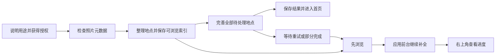

# 照片库准备、地点补全与地球扫描体验方案

日期：2026-09-10。状态：已按用户确认的方案展开并完成主要实现。第 1–11 节保留设计依据；实际实现、与建议结构的差异和验证证据见第 12 节。真机长期观看与性能测量单独列为待验收项。

## 1. 目标与已确认方向

把完整的地点准备变成应用主动承担的一项工作：首次建立索引时覆盖存量地点，此后自动处理照片库变化，结果保存在本机。用户不必先翻过每一页照片，才能逐渐得到城市与国家。

扫描同时是一段“自己的世界被点亮”的体验。首次扫描与重新扫描共用一张地球扫描页；右上角提供实时进度入口。随着发现照片坐标，地球逐步出现光点，并有节制地转向新发现的区域。地球和记忆始终是主角，进度信息与操作保持克制。

用户已明确的方向：

- 主动准备存量照片的国家、城市并持久化，建立存量与增量策略。
- 设置中的重新加载要有明确语义，并保留已经取得的成果。
- 顶部右侧提供扫描／补全进度入口。
- 首次与重新扫描使用统一页面，复用首页地球视觉。
- 数据发现与光点、镜头形成联系；镜头必须有防疲劳规则。

下文的按钮名称、调度参数、表结构与实施拆分是建议基线。全量任务覆盖范围、页面复用和进度可感知是目标；具体镜头节奏需要在电视前校准。

## 2. 现状：坐标展示成立，地名准备不完整

地球光点由照片 GPS 和本地聚类中心绘制，不需要先取得城市与国家。城市与国家则来自对地点中心的 MapKit 反向地理编码。扫描照片、生成地点和补全地点名称是三件不同的事。

截至 2026-09-10 08:40 的真机缓存抽样，762 个地点中已有 114 个完整地名，648 个仍待完善，涉及 19,104 张定位照片。这是当时的快照，不是实时统计；缓存也不能区分所有剩余地点是尚未请求还是请求失败。先前调试与验证见[地名缺失调试记录](PLACE_LABEL_DEBUG_2026-09-09.md)。

| 当前能力 | 缺口与本方案的调整 |
| --- | --- |
| 首页、分类、照片墙、详情共享串行解析器；成功结果逐项写回 SQLite | 请求仍主要由浏览触发，新增独立的全库地点准备任务 |
| 首页和分类按 15 + 10 准备，照片墙使用有限焦点窗口 | 保留页面与图片预算；这些预算不再决定全库任务能处理多少地点 |
| 扫描一次返回全部有效照片数组，再生成索引 | 增加有界批次、真实进度、检查点及流式聚类，避免把整库数据反复复制 |
| 启动读取缓存后直接进入地球 | 增加权限检查、跨启动变化核对及未完成任务恢复 |
| 重新扫描生成匿名地点，覆盖旧表 | 新索引在独立代次构建，复用有效地名，成功后原子启用 |
| 有效空扫描没有保存空索引 | 保存“已核对的空结果”，避免重启恢复旧照片数据 |
| 根页面在扫描页与 GlobeView 之间切换 | 提升唯一地图与相机宿主，让扫描、首页、探索自然交接 |

“一次性补完存量”指一项任务负责所有待完善地点，并能跨中断继续，不是同时对每张照片发请求。MapKit 可能限流、断网或无法为某些坐标返回城市，因此不能承诺所有坐标最终都有城市，也不能承诺固定等待时长。[Apple DTS 对反向地理编码限流的说明](https://developer.apple.com/forums/thread/795522)

## 3. 用户路径：首次、日常与手动更新

### 首次使用

1. 用户主动授权后进入统一扫描页；只读取轻量元数据，不下载全库图片。
2. 发现合法 GPS 时逐步点亮地球。完成本地整理并提交可浏览索引后，开放“先浏览”。默认继续留在扫描体验中完善地名。
3. 顺利完成后自然淡入首页，复用同一地图。若存在无法解析的地点，展示“本轮已结束，仍有 N 个地点待完善”，提供“进入地球”，不永久卡在最后一点进度。
4. 因网络或服务限流而尚有任务未处理时，显示等待原因与已保存成果；允许先浏览，之后恢复。
5. 首次扫描只覆盖当时已经同步到设备、应用获准访问的照片。扫描期间新增或后续 iCloud 同步到达的照片进入后续增量轮次，不承诺远端照片已全部同步。

### 已有索引的日常使用

先核验读取权限，再加载已保存的地点摘要，快速显示首页。在应用前台异步核对变化，恢复待处理地名；不每次启动都遮住首页播放完整扫描。

升级到此方案后，已有完整索引的用户直接启动一次“存量地名完善”，复用已有标签。它不必重新读取全库照片、不弹出扫描页面；用户可以从右上角主动进入完整体验。若还没有可信的变化基线，另行做一次轻量元数据复核以建立基线。

### 设置中的更新语义

| 入口建议 | 执行内容 | 展示 |
| --- | --- | --- |
| 更新照片与地点（主操作） | 检查变化、处理新增／编辑／删除，继续到期的地点补全；没有可信基线时做轻量复核 | 打开统一扫描页，复用正在进行的任务 |
| 继续完善地点（有剩余时显示） | 只恢复未完成地名，不重新扫描全部照片；尊重服务冷却 | 同一页面，从当前阶段继续 |
| 重新建立旅行索引（次级修复操作） | 完整重读元数据并重建地点与旅程；复用校验有效的地名 | 同一页面展示完整阶段；完成前保留旧成果 |
| 连接我的照片（示例模式） | 进入已有权限说明和授权流程 | 授权后进入同一扫描页 |

设置展示上次元数据核对时间、地点完整数／总数、待重试数及当前任务状态。不要只显示“索引生成时间”，让用户误以为地名也已经准备完成。

重复点击入口只打开当前任务，不启动第二个扫描器。重建操作不修改 Photos 内容，也不以清空已有地名作为默认动作。已有更新正在进行时，重建请求在安全检查点合并为下一次完整核对，页面明确显示“将在当前步骤保存后重新核对”。

## 4. 右上角进度入口

首页、最近到访、国家与城市、设置共享一个位置稳定的进度胶囊，避让原生侧边栏顶部区域。它使用标准 tvOS Focus；状态刷新只更新内容，不改变控件身份、位置或自动抢焦点。

| 状态 | 文案示意 |
| --- | --- |
| 检查元数据 | 检查照片 · 2,400 / 18,000 |
| 补全名称 | 完善地点 · 126 / 762 |
| 用户暂停 | 已暂停 · 636 个地点待处理 |
| 服务等待 | 等待重试 · 进度已保存 |
| 本轮结束但有缺失 | 还有 8 个地点待完善 |
| 已完整更新 | 照片与地点 · 已更新 |

有可靠分母时使用细进度环；阶段总量未知时只显示阶段和计数。暂停、失败和等待状态停止旋转。数字按固定宽度排版、最多每秒刷新两次，避免持续跳动。

完成后短暂保留结果，再收敛为安静的“照片与地点”入口；焦点在入口上时不收起。等待状态不反复弹窗。辅助功能只播报阶段切换和显著进度，避免逐照片播报。

直接操控地球、缩放工具条、全屏照片墙和照片详情隐藏该入口，维持已有遥控器语义和沉浸构图；退出这些场景后仍可查看。补全任务可以继续，但不得因此移动这些场景的背景地球。

## 5. 统一扫描页：看见自己的世界被点亮

### 构图与信息

扫描页沿用首页纯卫星、真实地形和近轨道巨大地球，保持 full-bleed、少量深空与克制蓝白光点。左上方放一行轻标题，例如“正在点亮你的世界”；下方以紧凑信息区展示当前阶段、主要计数、最近确认的地点。地名只放在信息区，不铺在地表上。

底部为轻量原生 Glass 操作区，提供“先浏览／返回”“暂停扫描／继续”“暂停画面移动／继续跟随”。仅显示当前可用的操作，并为 MapKit 署名保留至少 88 pt 净空；不堆叠每张照片的日志、错误码或多个仪表盘。

首次整理尚未得到可靠地名时使用“发现一片新的记忆”等中性文字，不能用最近已知城市冒充当前坐标。读到 GPS 即可显示光点；地名取得后更新信息区和统计，不再给同一地点叠加第二个点。

| 阶段 | 主进度 | 辅助信息与地球表现 |
| --- | --- | --- |
| 检查照片 | 已检查图片 / 本轮快照图片数 | 已发现有效 GPS 照片数；有界临时区域光点逐步出现 |
| 整理地点 | 已处理有效照片 / 有效照片总数 | 已生成地点数；临时点逐步替换为最终聚类摘要 |
| 完善地点 | 城市国家完整地点 / 本轮地点总数 | 已尝试、待处理、部分结果、待重试；展示真实取得的地名 |
| 保存更新 | 真实提交状态 | 只有发生提交时展示；不安排人为“最后 1%” |
| 等待或暂停 | 当前阶段和已保存计数 | 停下原因、剩余数量及继续入口 |
| 结束 | 已准备照片数与地点完整情况 | 区分全部完整、部分完成、无定位照片和空库 |

进度规则：

- 分母固定在本轮快照；新变化进入后续轮次，不让当前百分比因新增照片倒退。
- 临时区域点数量不是城市数，也不是最终地点数。“地点”代表聚类得到的访问位置，同一城市可能包含多个地点。
- 名称完整比例只统计同时具有有效城市和国家的地点；“已尝试”不能替代“已完整”。补充“这些地名已覆盖 N 张照片”，帮助用户理解一次请求可服务多张照片。
- 不构造元数据 30%、聚类 20%、地名 50% 之类缺少依据的总进度。主进度随阶段切换，并标明阶段。
- 已写入 SQLite 的结果才算“已保存”。请求成功但落盘失败时保留内存结果、显示保存异常并重试，不能报持久化完成。
- 某些坐标可能只有国家或没有对应城市。照片与 GPS 仍可浏览，保留真实字段和“地名待完善”，不猜测补齐。

### 页面生命周期与返回

关闭扫描页、暂停任务、应用进入后台是三个独立事件。关闭页面只交还导航和相机，应用前台仍继续处理；“暂停扫描”才停止取新工作并保存检查点。“暂停画面移动”仅停止自动镜头。

从已有页面进入时保存来源、列表位置、Focus 与相机。Back 返回同一来源，不弹取消确认，不把最后扫描区域变成新的浏览选择。首次尚无可浏览索引时，Back 返回已授权的准备入口，保留任务成果，避免重复请求授权；索引可用后可直接先浏览。

首次顺利完成且用户仍停留在首次流程时可自然进入首页；用户主动打开的更新详情完成后保留结果页，等待“返回”。用户已先浏览时，任务完成只更新入口，不能自动跳页面。

## 6. 光点与防疲劳镜头

### 光点实时更新，镜头只选取代表事件

数据处理不等待动画，动画不决定进度。GPS 扫描事件先汇总为临时地理区域；最终地点生成后使用正式摘要。地图仍遵守世界视角最多 180 个代表点、每个 2° 网格最多 2 个，使用现有缓存柔光位图，不逐照片创建标注。

新点轻微淡入，不使用脉冲、空心圈、路线或逐点实时模糊。重新扫描保留旧地球，新数据逐步确认和补充；不能为了重新点亮的视觉效果先清空已有成果。某一地区的数据已处理但因 LOD 没有独立光点，不影响真实进度。

为镜头增加独立调度器，输入是批次发现的区域和已确认地点，输出是少量相机目标。区域划分只用于视觉合并，不用于推断城市或复用地名。

镜头候选须与光点 LOD 联动：目标区域至少一个真实代表点已经进入本次标注集合，才允许启动飞行。可在既有 180 点与每网格 2 点的上限内为当前目标保留或替换一个名额，不能额外叠加。这样镜头抵达时有对应的记忆光点，不会因代表点被裁掉而转向一片没有标记的地表。

### 建议的首版节奏参数

以下是集中配置、可测试的起点，不是已经验证的最佳手感；所有限制同时生效。

| 规则 | 建议基线 |
| --- | --- |
| 事件合并 | 每秒汇总一次；邻近事件合并，最多保留 24 个区域候选，超过 120 秒的候选过期 |
| 近处不移动 | 已在当前可见区域内，或距当前中心小于约 12° 球面夹角，只点亮与更新信息 |
| 最小间隔 | 两次飞行启动至少间隔 20 秒，停稳后至少静观 10 秒 |
| 移动总预算 | 任意滚动 60 秒内最多 2 次飞行；任意滚动 30 秒内移动时间最多 10 秒 |
| 飞行时长 | 普通目标约 4–6 秒；跨洲目标约 6–8 秒，必须有剩余移动预算 |
| 地区冷却 | 同一区域 90 秒内不重复；识别 A→B→A 往返并延长冷却 |
| 长时间观看 | 连续观看超过 2 分钟后最多每分钟 1 次；超过 5 分钟后只更新光点，用户可主动继续跟随 |
| 正在飞行 | 不被新照片抢占目标；只更新下一批候选，禁止逐条中断重启 |

目标选择依次考虑尚未展示的新区域、等待时间、与当前镜头的距离和该区域新发现照片数。照片数权重封顶，避免常驻地因照片多而一直占据镜头；距离只是平滑取景偏好，不能让远方区域永久得不到展示。相同条件使用稳定排序，便于复测。

没有合适目标就静止，不持续自转填充等待。跨日期变更线按最短球面方向移动；接近对跖目标时使用稳定方向，不能因浮点扰动左右反复。自动镜头维持近轨道尺度与 heading 0°，复用现有纬度／距离俯仰策略与原生相机回读，不飞进城市街区。

“2 次／分钟”不是要求一定转两次，而是上限。批次更新再密集也不追加动画队列；离开扫描页、任务结束、暂停或系统失活立即停止后续调度，重新进入不回放积压事件。完成时可短暂平缓收束当前运动，不为播放完队列延长扫描。

### 相机所有权与辅助功能

优先级为系统状态与辅助功能约束、用户返回／浏览、扫描页镜头、首页自动锚定。扫描只在页面可见且应用活跃时获得相机；后台补全不影响用户正在看的地球。

扫描页使用标准 Focus，不安装探索场景的直接操控输入，不触发底部记忆照片带的视野查询。所有飞行经过同一个相机显示帧循环，最高 30 fps；地图 bounds 固定，不创建第二颗地图或第二套帧循环。

返回已有页面时恢复进入前的相机和 Focus。首次结束时，统一宿主先决定首页目的地：可用系统位置优先，否则最近旅行地；在交接阶段最多完成一次平缓收束，随后交还首页，防止首页定位与扫描末尾镜头同时写相机。

Reduce Motion 开启时取消自动飞行和自转，固定构图、静态更新光点和计数；Reduce Transparency 使用可读深色实底。地图瓦片慢或未高清时数据准备继续，不能用地图的渲染完成回调代替地名完成状态。

## 7. 存量地点补全：独立、持久、可恢复

### 一个全应用任务与一个请求队列

新增应用级准备协调器，由 AppModel 持有，不依附页面的 .task。它负责阶段、批次、暂停、恢复和完成判断；MapKit 查询继续复用已有全局串行、去重、可取消解析器。

存量任务从 SQLite 分批读取所有未完整地点，例如每批最多 32 个待处理描述，只按地点中心请求。即使用户一直停在首页第一屏，也会继续向后处理；已完整缓存直接跳过。

优先处理当前详情／焦点地点，其次首页有限可见地点，再处理其余存量。前台需求可提前已排队地点，但不能绕过全局速率，也不能无限挤占存量：存在两类需求时，建议最多连续处理 3 个页面优先请求后至少处理 1 个存量地点。仅有一类需求时正常前进。

页面关闭只移除自身订阅；全库任务仍需要同一地点时请求继续。暂停全库任务后，用户主动浏览产生的有限地点查询仍可工作；暂停状态说明为“全库扫描已暂停”。跨索引结果必须校验 generation 与查询依据，不能回写到已经改变的地点。

### 请求节流与失败收敛

- 全局保持串行，相邻实际请求以 2 秒为初始节奏；连续 12 次健康响应后降至 1.75 秒，再连续 12 次降至最低 1.5 秒。任一瞬时服务错误恢复 2 秒基线，明确限流仍进入全局冷却；这不是 Apple 保证的配额，重试也占同一预算。
- 沿用当前单次请求 15 秒超时，瞬时失败最多 3 次尝试、2 秒与 5 秒退避；收到明确限流或连续服务失败时暂停整个队列，避免把数百个地点逐个打成失败。
- 服务级冷却建议按 1、2、4、8、15 分钟递增，上限集中配置；恢复时先放行一次探测。离线期间不让每个地点独立开启重试计时器。
- 找不到地名／字段不全保留真实结果并结束本轮该地点的尝试，不即时循环。持久化 nextRetryAt，最低冷却 60 秒；同一依据反复无结果时延长至后续维护轮次，不能每分钟永久重查全库。
- 手动继续可重试允许执行的失败项，但不能绕过明确限流冷却；页面呈现剩余等待时间或等待原因。
- 所有本轮候选已经完成有限尝试且只剩部分／无结果时，状态为“本轮结束，仍有待完善”。因网络中断而仍有未尝试候选时，状态为“等待恢复”，不冒充完整完成。

MapKit 正式提供反向地理编码，Apple DTS 已说明新接口仍受限流约束；公开讨论中的具体频次样本不作为产品固定配额，也不据此承诺完成时间。[MapKit 反向地理编码](https://developer.apple.com/documentation/mapkit/mkreversegeocodingrequest)、[Apple DTS 说明](https://developer.apple.com/forums/thread/795522)

### 持久化与复用依据

建议在 SQLite 增加准备任务与地名查询缓存，字段至少覆盖：任务类型／阶段／轮次、快照统计、待处理游标、地点查询依据、状态、尝试次数、nextRetryAt、已取得字段、更新时间与可用版本。运行中记录在重启后回到可领取状态，避免永远卡在 running。

成功结果以小事务同时保存标签、任务状态和计数，再发布持久化进度。纯内存缓存不是完成依据；应用崩溃后最多重做未提交的一小批，不丢已完成结果。

地名不能仅依靠 placeID 复用：当前地点 ID 来自组内照片标识，成员变化会改变 ID，也可能 ID 不变而中心移动。复用键需包含实际查询坐标、解析规则版本和语言环境；首版优先只复用相同查询依据的结果。相同 ID 且坐标依据未变可继承，ID 变化但查询依据一致也可共享；中心改变则重新确认。

不把 30 km 聚类半径或粗地理网格当作城市／国家缓存有效范围，避免边境和相邻城市误标。部分结果只能与相同依据的已知字段合并。当前索引只有地点中心，没有更完整的历史查询版本：迁移时只为明确有效的完整标签建立带来源的缓存，不把匿名标签和半空标签标成成功。

## 8. 增量照片策略：以变化记录保证正确性

运行期间注册 PHPhotoLibraryChangeObserver，合并短时间内的变化通知；跨启动保存 PhotoKit 持久变化令牌。不能只按拍摄日期取“最近照片”，旧照片导入与过去照片的 GPS 修改都可能发生在今天。当前 tvOS SDK 已包含相关持久变化 API；令牌可以过期，过期后必须重新建立可信基线。[PHPhotoLibrary](https://developer.apple.com/documentation/photos/phphotolibrary)、[读取持久变化](https://developer.apple.com/documentation/photos/phphotolibrary/fetchpersistentchanges(since:))

| 变化类型 | 元数据与索引处理 | 地名处理 |
| --- | --- | --- |
| 新增照片，包括拍摄于多年前的导入 | 读取变化资产；有效 GPS＋日期才进入地理索引 | 新／改变的地点入队，旧有效标签复用 |
| 原先没有 GPS，后来添加 GPS | 变化监听覆盖所有图片资产，不能只检查已索引 ID | 加入索引与地点准备 |
| GPS／拍摄日期被编辑 | 重算相关派生数据，可能移动地点或旅程边界 | 坐标依据改变的标签重新确认 |
| GPS／日期移除，或照片删除 | 移出照片表、RTree 与地点计数，更新封面及空地点 | 删除无需求任务，保留符合缓存政策的可复用结果 |
| 收藏、尺寸、图像内容变化 | 更新展示元数据、封面候选与对应图片缓存 | 一般无需重新地理编码 |
| 权限范围变化 | 核对当前可读范围，立即停止提供已不可访问的照片 | 仅处理授权范围，撤销无权访问的数据任务 |
| 令牌过期、基线缺失或缓存异常 | 执行完整轻量元数据复核，建立新基线 | 复用仍可信标签，补全差额 |

### 增量读取与聚类重算分开

首版采用“增量取得 PhotoKit 元数据，必要时流式重算本地派生索引”。纯收藏／尺寸更新不重建旅行；新增、删除、时间或坐标变化时，先合并变化批次，再从 SQLite 按拍摄时间与稳定 ID 顺序重算地点／旅程。

这是当前顺序聚类算法的正确性边界：它使用运行中心和时间间隔切分，一次旧照片编辑可能使后续组边界连锁变化。首版不宣称只重算一个固定半径就与完整算法等价。后续若引入局部重算，必须用与全量结果一致的测试证明边界。

流式聚类保留球面中心累计值、时间范围、封面候选和稳定 ID 种子；成员关系批量写到 staging，避免在一个 5 万张照片的地点内反复遍历全部成员。首次元数据也按有限批次写入，UI 只接收计数、摘要和有界光点事件。

### 令牌与数据一起提交

1. 初次完整核对先注册变化观察并捕获起点令牌 T0，再开始读取照片快照。
2. 快照完成后重放 T0 以来的变化，取得这一批实际处理到的安全令牌；重复资产更新按 ID 幂等合并。
3. 元数据、派生索引、需要补全的任务及安全令牌在对应代次提交成功后一起生效。只推进已处理变化自带的令牌，不把完成时随手读取的“当前令牌”当成已处理位置。
4. 此后抵达的新变化进入下一轮。不要为了追上持续导入而让首轮永远不结束。
5. 崩溃后从最后提交令牌重放，不能只保存令牌而漏存照片。缓存被清除时令牌也失去基线意义，不能拿另处残存令牌跳过重建。

正常启动优先查变化；另建议距离上次完整核对超过 7 天时，在应用前台低优先级安排一次轻量复核，合并用户主动更新，避免一天多次全扫。周期是可调工程起点，完整复核用于发现遗漏和修复差异，不重新清空地名。

## 9. 重建、异常与中断恢复

### 索引切换

建议 SQLite 使用 active 与 staging 两个逻辑代次：当前可浏览代次保持可读，新的元数据和聚类在 staging 准备。元数据暂存采用有限批次事务；最终派生索引批量构建使用预编译语句与事务，不逐记录提交。校验成功后以一次小事务切换 active_generation 及变化令牌。

首次可以先启用已完成本地整理的可浏览代次，再逐项完善名称。日常更新和手动重建也无需等待所有网络请求成功才启用有效元数据；新代次先附上可复用标签，其余继续补全，UI 明确标出名称准备状态。

照片表、RTree 和查询都必须按所读代次一致过滤。已有照片墙分页在当前会话固定读取代次，正常退出后再切换；旧代次待读者释放后清理，避免改到下一页时重复／漏照片或 Focus 跳动。权限收回及明确删除优先立即隐藏相关资产，不能借固定代次继续展示已无权访问的数据。

新代次构建失败保留旧成果。全量核对成功且结果为零时同样提交合法空索引，不能因为没有地点而保留旧库。拒绝授权、库暂不可读、扫描中断都不是“零张照片”，不得据此提交空库。

旧 schema 升级应优先做已支持的小迁移，保住已解析标签；确实不兼容或损坏时才按既有规则清理缓存及 WAL／SHM 并重建。任务、缓存和照片都在本地派生层，不能把令牌、照片 ID 或坐标放入 KVS。

重建期间旧索引仍可能取得新地名。这些结果先写入独立的查询缓存；启用 staging 前，在短事务中合并查询依据相同的最新结果，不能只复制重建开始时的标签。代次也必须有保留上限：至多一个待启用代次和必要的正在阅读代次；连续变化合并处理，不能因用户长时间停在照片墙而无限保留整库快照。

### 中断与等待

| 情况 | 预期行为 |
| --- | --- |
| 关闭扫描页 | 页面退出，前台任务继续，恢复来源 Focus 与相机 |
| 用户暂停扫描 | 停止领取新批次；在途工作安全取消或完成提交，保留成果；下次仍尊重主动暂停 |
| 应用进入后台／Apple TV 休眠 | 停止镜头与新请求；依赖已持续保存的检查点，恢复前台后继续非用户暂停任务 |
| 进程被杀 | 根据持久任务恢复；未提交的扫描批次可能重做，已保存地名不重查 |
| PhotoKit 元数据扫描中断 | 无可信可恢复快照时重新枚举轻量元数据，不用数组 offset 假设图库顺序未变；沿用已保存名称 |
| 网络或限流 | 保留当前有效索引，等待全局冷却／网络恢复，允许浏览 |
| 磁盘写入失败 | 不切换到未保存代次，说明保存失败并保留旧可读成果 |
| 权限撤回 | 停止读取和补全、隐藏不可访问内容，回到权限状态；不把拒绝误判为空库；重新授权或范围变化后重新核对可见资产基线 |

这里的“后台补全”主要指用户在应用内浏览其他页面时继续工作。系统后台执行机会有限，方案不承诺退出应用或电视休眠后仍持续跑完整个图库；恢复能力来自运行期间的持续持久化，而不是寄希望于退出前最后一次回调。[Apple 后台执行说明](https://developer.apple.com/documentation/xcode/configuring-background-execution-modes)

## 10. 实施边界与拆分

| 模块 | 计划职责与现有接点 |
| --- | --- |
| 准备协调器（新增） | 单一任务、阶段状态、全库队列、暂停恢复；由 AppModel 持有 |
| PhotoLibraryService | 批次扫描、真实计数、变化观察、持久令牌；取代仅一次性数组返回的接口 |
| TravelClusterer | 保持纯 Swift、稳定顺序与既有聚类语义，增加流式输入和有界输出 |
| TravelIndexStore | staging／active、任务表、地名缓存、小迁移、空结果及安全游标提交 |
| MapKitPlaceLabelResolver | 复用现有共享队列，增加全局预算、服务冷却、页面优先与存量公平性 |
| 持久地球场景宿主（新增／重构） | 将当前 GlobeView 内地图和相机所有权提升到根场景；扫描、首页与探索使用同一实例 |
| 统一扫描页与进度入口（新增） | 只订阅状态、发出操作；不持有业务任务、不逐照片发布 SwiftUI 更新 |
| 扫描镜头调度器（新增） | 纯规则选择有限区域，向现有相机帧循环发目标，不直接调用第二套动画 |
| SettingsView、首页和分类等 | 接入统一入口，保持原生侧边栏、Focus 身份和既有图片加载预算 |

建议按以下顺序交付，每一步均有可验证结果：

1. **先保障成果保存**：缓存迁移、名称复用、有效空库、任务检查点、staging 原子切换和旧结果失效。
2. **补齐主动准备闭环**：存量任务、全局节流、真实阶段计数、升级用户继续补全；页面补查保留作补救。
3. **实现统一地球扫描体验**：持久地图宿主、右上角入口、首次／更新页、光点事件、镜头预算、Focus 和 Back 交接。
4. **接入增量维护**：Observer、持久变化令牌、扫描期间变化核对、流式聚类与周期复核，统一设置语义。
5. **真机整体验收**：从当前有大量待完善地点的状态到逐项持久化、退出重开继续，再验证新增／编辑／删除和扫描镜头。

同一版本内完成这条闭环后再对外称为“照片与地点自动准备”。各阶段测试通过不能代替整体体验验收。

## 11. 验收标准

| 领域 | 必须验证的结果 |
| --- | --- |
| 存量覆盖 | 不翻列表也会处理首页之外的待完善地点；已有完整字段不重复请求；成功落盘并重启可读 |
| 进度真实性 | 阶段分母正确；照片数、地点数、尝试数与完整数分开；部分结果不能显示地名 100% |
| 故障收敛 | 超时、无结果、部分字段、离线、限流均能退出忙等；有限重试不形成全库请求风暴 |
| 增量正确性 | 旧照片导入、GPS 添加／删除／修改、日期编辑、资产删除、收藏变化、权限变化均被处理 |
| 并发与恢复 | 扫描中新增照片不丢；令牌与数据提交一致；关闭页面不取消全库任务；休眠／杀进程后恢复 |
| 重建安全 | 成功标签按依据复用；失败保留旧库；真空库提交空结果；拒绝权限不清空为零；旧回调不污染新代次 |
| 页面稳定 | 进度更新不抢焦点；扫描页 Back 恢复来源位置；分类变化不让照片墙分页失序；已有地球四层 Back 不回归 |
| 镜头防疲劳 | 海量同地照片不反复飞；全球交错事件仍满足滚动时间预算；长时间减频；退出／完成不回放积压 |
| 地球一致性 | 扫描与首页复用同一 MKMapView；相机仅一个所有者／帧循环；日期变更线、极区与相机回读约束正确 |
| 无障碍与大屏 | Reduce Motion 无自动转动；Reduce Transparency 可读；1920 × 1080 构图、原生 Focus 与署名净空通过复核 |
| 性能 | 5 万张带位置照片含单地点极端数据；内存有界、后台批量写入、不逐照片刷新界面；地图标注与相机提交上限有效 |
| 真机 | 测量扫描与正常浏览并行时的帧时间、内存和响应；电视前连续观看至少 5 分钟，确认镜头舒适、进度可读 |

单元测试覆盖状态、令牌事务、缓存依据与镜头规则；集成测试覆盖 SQLite 重启／代次与 PhotoKit 变化输入；UI 测试覆盖入口、返回、暂停和焦点。使用中性模拟照片做自动化与截图，真实库验证只记录聚合计数、字段是否存在和错误域／码，不记录照片 ID、地名、精确坐标或错误 userInfo。

方案文件对应的本轮工作只做文档核对。既有调试记录中的构建、测试和真机安装结果属于旧功能，不能作为以上新功能已实施的证据。

## 12. 2026-09-10 实现与验证记录

### 已接入的完整路径

- `LibraryPreparationCoordinator` 由 `AppModel` 持有，全库地名准备独立于首页、分类和照片墙的加载窗口。已有索引启动后立即可浏览，应用前台继续准备所有待完善地点；首次授权、设置更新与重建进入同一 `LibraryPreparationView`。
- `ContentView` 保留 `GlobeView` 宿主，唯一 `MKMapView` 位于原生 TabView 之外。扫描页面只更换前景 UI 和相机控制权；关闭页面恢复来源页面与镜头。四个顶层页面均有同一位置的原生 Glass 进度入口，入口位于对应 Tab 的 Focus 环境中。
- 扫描分为照片核对、地点整理、地名补全、保存、等待／暂停／部分结束／完成。照片数、完整地点数、覆盖照片数和本轮尝试数分别记录；进度以实际提交的 SQLite 结果为依据。元数据未有分母时显示正在核对，不显示 `0 / 0` 或伪造总百分比。
- 扫描页可先浏览、暂停全库工作、单独暂停镜头。暂停意图先持久化，再等待仍有其他订阅者需要的共享查询结束；重启尊重用户暂停。应用失活停止镜头和新工作，回到前台继续非用户暂停任务。
- 设置使用“更新照片与地点”“继续完善地点”（存在待完善地点时显示）和“重新建立旅行索引”；示例状态仍为连接本人照片库。索引有效为空时保存空结果，后续变化可重新点亮地球。

### 存量、增量和持久化

1. PhotoKit 完整扫描只读取图片轻量元数据，每批最多 256 张；初始变化令牌在获取资产快照前捕获，扫描后回放持久变化，安全令牌与数据同一事务提交。
2. Observer 合并一秒内通知；变化读取包含新增、删除、过去照片的位置／时间编辑、收藏和尺寸变化，不按拍摄日期推断增量。令牌过期或变化详情不可用时转完整核对；没有可信基线、授权范围变化、主动重建或距上次全量核对七天也会完整核对。
3. 结构变化从 SQLite 按日期和稳定 ID 流式生成地点与旅程。单个 50,000 张照片的地点不保存组内数组、不重复计算整个组的质心。纯收藏／尺寸更新保留聚类及生成时间，并更新封面选择。
4. 地名缓存依据为查询中心的精确坐标、来源／字段版本和语言。不能仅凭旧地点 ID、显示网格或 30 km 聚类半径复用城市。重建开始前及提交时均合并已有完整缓存；重建期间新解析出的名称不会被匿名新索引覆盖。
5. MapKit 全应用串行、去重，实际请求起点初始至少间隔两秒；健康响应自适应降到 1.75 秒和最低 1.5 秒，瞬时错误恢复两秒。页面查询优先，最多连续三个前台请求后让出一个全库请求。单次原生查询最多 15 秒，瞬时失败有限重试；限流、离线或连续失败进入整个服务的 60 秒至 15 分钟冷却。
6. 全库每批领取最多 32 个待处理地点。缺少城市或国家不计入完整成功，保存已有字段与下次尝试日期，延后约一小时并逐步延长至七天。前台定时恢复；不承诺系统后台或休眠期间持续执行，也不承诺每个坐标都有可解析城市。
7. 撤销访问时立即隐藏私有索引与照片界面，停止准备并使变化基线失效；不可读和读取失败不当成空库删除。正常删除及 GPS 移除会使当前已展示照片失效。日志及验证仅保留聚合计数和固定错误域／码。

### 与第 9 节建议表结构的差异

本轮保留现有 v3 活跃表，新增暂存照片、准备状态、同步状态和地名缓存表；未给每条照片增加 `indexGeneration` 列，也未复制或替换正在使用的 SQLite 文件。

- 新元数据先进入 `scan_photos`；聚类完成后在一个 SQLite 事务中替换活跃照片、RTree、地点和旅程，并提交安全令牌。失败或取消回滚该事务，原成果仍可读取。
- 已打开的照片墙取得独立 WAL 读事务，固定进入时的记录与地点摘要，因此后续页不会因新索引启用发生重复、遗漏或串入新的所属城市。对旧照片墙补查地名时使用该快照的查询中心，并校验当前地点依据再写回。
- 最多两个读取租约；旧照片墙持有快照时允许一次完整替换，之后的新一轮替换等待旧墙退出。等待原因显示在扫描页，避免长期持有旧快照导致连续整库 WAL 增长。释放快照后恢复提交，活跃索引的正常地名写入继续。
- 元数据扫描中断后重新枚举当前轻量快照，不用旧数组偏移假设图库排序未变。已持久化的有效地名和安全令牌继续复用。

以上达到“旧成果可用、新成果原子启用、照片墙固定快照”的同一目标，复用了已有分页和 RTree 结构。

### 地球节奏的实际参数

`ScanCameraDirector` 将发现事件合并为区域候选，最多保留 24 个；候选超过两分钟失效。已有视野内或相距不足 12° 的地点只更新数据，不移动镜头。

- 单次飞行约 5 秒，跨越较大地理距离约 8 秒；使用大圆插值和现有统一相机帧循环，跨日期变更线走短弧。
- 两次飞行起点至少相隔 20 秒，镜头停留至少 10 秒；任意 30 秒窗口移动不超过 10 秒，任意一分钟最多两次飞行。
- 两分钟后降低到每分钟最多一次，五分钟后自动停止跟随并保留继续入口。同一区域冷却 90 秒，往返区域提高到 180 秒。
- 关闭／重开扫描页面只建立新的事件基线，不重播此前积累的发现。Reduce Motion、用户暂停画面、任务停止和应用失活均停止自动镜头；不打断用户正常浏览的地球。
- 光点仍使用现有柔光位图和 LOD，上限 180 个、每个 2° 网格最多两个；飞行目标优先进入绘制预算。GPS 区域发现与正式地名补全分别反馈，最近补充地名明确标为“刚补充”。

### 验证与真机证据

工作证据保存在 Git 忽略目录 `.local-test-data/preparation/validation/`。测试均使用中性示例照片，不以真人图库做 UI 截图。主要覆盖：全库超过首屏预算、缓存精确复用及迟到结果、GPS／日期／删除／旧照片导入、令牌过期、合法空库、权限撤回、暂停恢复、共享查询、公平调度和服务冷却、WAL 跨页一致性与租约释放、50,000 张同地点聚类、镜头滚动窗口预算与日期变更线。

- `Complete.xcresult`：187 项单元测试及两条扫描 UI、原生侧边栏全路径通过（190 项结果，零失败）。
- `NavigationFinal.xcresult`：首页地点进入／返回、地球照片墙与详情逐层返回、长按缩放工具条、首页货架展开四条原有流程通过。首次扫描后的侧边栏测试曾在未等待原生 Focus 交接时失败；已补明确的首页及侧边栏焦点等待，再验证设置更新与重建路径。不能把这一失败轮次写为全绿。
- 定向测试曾发现旧聚类编号偏移与 SQLite 时间精度问题，均修正；扫描控件的辅助功能分组、右上角入口的原生 Focus 环境和进度条动画滞后也已修正。原生 Glass 包装层不始终把 `hasFocus` 报给内部按钮，入口以方向键进入、实际中键打开及 Back 后中键重开验证交互。
- 真机更新前：22,730 张定位照片、762 个地点、114 个完整地名，覆盖 3,626 张照片，SQLite 完整性正常。
- 第一轮正常启动后回读：照片与地点数量不变，134 个完整地名，覆盖 3,975 张照片；新增 20 个完整地点、覆盖增加 349 张照片。已保存准备阶段、真实计数和 PhotoKit 安全变化令牌，另有部分尝试未取得完整字段，未冒充成功。

最终收尾结果：

- `Verified.xcresult`：最终 189 项单元全部通过，扫描暂停／继续／先浏览／右上角重开及返回入口流程通过；设置重建返回按钮的焦点检查在这一轮失败，随后修复 `SettingsView` 的来源操作恢复。
- `SettingsFocus.xcresult`：修复后的首次扫描自然进入首页、设置更新、重建及准确返回原按钮整条流程通过；原生侧边栏、国家／城市照片墙与设置左右寻址再次通过。
- `QueueTiming.xcresult`：14 项地名队列回归通过；使用后续立即返回的查询验证实际请求间隔，避免把服务本身耗时当成节流证据。结合上述轮次，189 项单元与 7 条不同的 UI 流程均取得通过证据；不同轮次的失败与修复范围分别保留，不合并伪造单个全绿结果包。
- 最终 `release-final-settings.log`、`device-final-settings.log` 构建成功，`codesign-final-settings.log` 严格签名验证通过。最终源码与 Debug／Release 可执行文件 SHA-256 位于 `final-source-manifest.json`。
- 重启后冷读副本：159 个完整地点，覆盖 4,356 张照片；此前 134 个完整名称及精确查询坐标全部保留，完整核对时间未改变，变化令牌存在。相比安装前增加 45 个完整地点、覆盖增加 730 张照片，定位照片仍为 22,730 张、地点仍为 762 个，SQLite 完整性正常。此时剩余 603 个地点待完善，不声称这些位置均可取得城市。
- 冷读副本在正常停止进程后复制，连同 WAL／SHM 一并保留在本机忽略目录，验证未修改真实 PhotoKit 资产。最终含设置 Focus 修复的产物已重新安装，并以无示例参数的正常模式启动，PID 12936；保留应用前台继续全库任务。
- 已人工复核扫描中、暂停、首页入口、重新打开及设置重建的模拟器截图，进度条与计数一致，文字／控件无重叠、MapKit 署名可见。`git diff --check` 通过，临时验证 scheme 已移除。

### 仍需电视前验收的项目

真实 Apple TV 连续观看至少五分钟的镜头舒适度、扫描与浏览并行的 GPU 帧时间／峰值内存和真实遥控器手感，尚未完成测量。模拟器与已有 MapKit 取景的局部残影限制继续保留，本次功能与截图不代表这些旧问题已经解决。真实库的剩余地点由应用前台继续处理；不把自动队列已运行等同于全部地点都有完整地名。
